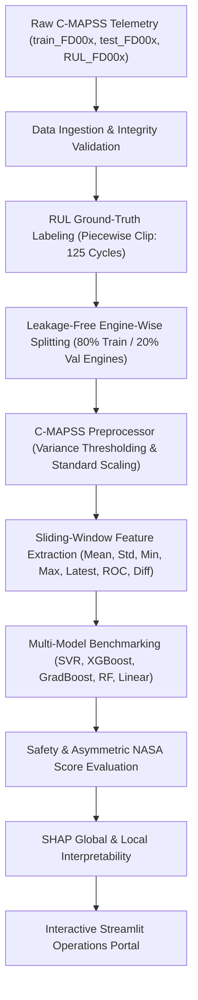

# ✈️ AeroGuard: Intelligent Aero-Engine Degradation Monitoring & Remaining Useful Life (RUL) Prediction

[](https://www.python.org/)
[](https://opensource.org/licenses/MIT)
[](https://streamlit.io/)
[](https://data.nasa.gov/)
[](#unit-tests)

AeroGuard is an end-to-end, research-grade prognostic health management (PHM) system designed to estimate the **Remaining Useful Life (RUL)** of turbofan jet engines. By leveraging multivariate thermodynamic sensor telemetry, leakage-free engine-wise validation, sliding-window temporal feature extraction, multi-model regression benchmarking, asymmetric safety scoring, and SHAP explainability, AeroGuard transforms scheduled inspection intervals into a condition-based, predictive aerospace maintenance protocol.

---

## 📑 Table of Contents
1. [Problem Statement & Scientific Methodology](#-problem-statement--scientific-methodology)
2. [NASA C-MAPSS Turbofan Dataset](#-nasa-c-mapss-turbofan-dataset)
3. [System Architecture & Leakage Prevention](#-system-architecture--leakage-prevention)
4. [Sliding-Window Feature Engineering](#-sliding-window-feature-engineering)
5. [Empirical Model Benchmarking Results](#-empirical-model-benchmarking-results)
6. [Safety-Critical Early-Failure & Overestimation Risk](#-safety-critical-early-failure--overestimation-risk)
7. [Explainable AI (SHAP Sensor Attribution)](#-explainable-ai-shap-sensor-attribution)
8. [Interactive Aerospace Dashboard](#-interactive-aerospace-dashboard)
9. [Project Directory Structure](#-project-directory-structure)
10. [Installation & Execution Guide](#-installation--execution-guide)
11. [Unit Tests](#-unit-tests)

---

## 🎯 Problem Statement & Scientific Methodology

Modern aviation safety demands moving away from fixed flight-hour overhauls toward real-time condition-based maintenance. Turbofan engines experience thermal fatigue, blade erosion, and compressor fouling, gradually degrading performance until functional failure.

AeroGuard addresses this challenge by:
1. **Multivariate Degradation Tracking:** Analyzing 21 continuous sensor channels capturing temperature, pressure, rotational speeds, and flow ratios across operational flight cycles.
2. **Piecewise-Linear RUL Modeling:** Assigning true RUL labels clipped at a maximum horizon ($R_{\text{clip}} = 125$ cycles) to reflect nominal pre-degradation baseline flight.
3. **Leakage-Free Engine-Wise Splitting:** Enforcing strict grouping by engine ID during validation (80% train engines, 20% validation engines) to prevent temporal data leakage.
4. **Asymmetric Safety Error Penalty:** Implementing the official NASA PHM asymmetric scoring function that severely penalizes dangerous RUL overestimations (delayed maintenance) over conservative underestimations.
5. **Explainability & Decision Support:** Translating ML predictions into physical component failure modes using TreeExplainer SHAP attribution.

---

## 🛰️ NASA C-MAPSS Turbofan Dataset

The system uses the **Commercial Modular Aero-Propulsion System Simulation (C-MAPSS)** dataset generated by NASA Ames Research Center:

| Dataset Subset | Train Trajectories | Test Trajectories | Flight Conditions | Fault Modes |
| :--- | :---: | :---: | :---: | :--- |
| **FD001** | 100 engines | 100 engines | 1 (Sea Level) | High Pressure Compressor (HPC) Degradation |
| **FD002** | 260 engines | 259 engines | 6 Conditions | HPC Degradation |
| **FD003** | 100 engines | 100 engines | 1 (Sea Level) | HPC & Fan Degradation |
| **FD004** | 248 engines | 249 engines | 6 Conditions | HPC & Fan Degradation |

### Sensor Telemetry Channels:
- **Temperatures:** T2 (Fan inlet), T24 (LPC outlet), T30 (HPC outlet), T50 (LPT outlet)
- **Pressures:** P2 (Fan inlet), P15 (Bypass-duct), P30 (HPC outlet), Ps30 (Static HPC outlet), epr (Pressure ratio)
- **Rotor Speeds:** Nf (Physical fan speed), Nc (Physical core speed), NRf (Corrected fan speed), NRc (Corrected core speed)
- **Flow & Enthalpy:** phi (Fuel flow to Ps30), BPR (Bypass ratio), farB (Burner fuel-air ratio), htBleed (Bleed enthalpy), W31/W32 (Coolant bleeds)

### Invariant Channels Purged in FD001:
In single sea-level operating regimes, sensors with zero variance ($\sigma \le 10^{-4}$) carry no diagnostic signal:
`op_setting_3`, `sensor_1 (T2)`, `sensor_5 (P2)`, `sensor_10 (epr)`, `sensor_16 (farB)`, `sensor_18 (Nf_dmd)`, `sensor_19 (PCNfR_dmd)`.

---

## ⚙️ System Architecture & Leakage Prevention



---

## ⏳ Sliding-Window Feature Engineering

Instantaneous sensor snapshots are often contaminated with high-frequency aerodynamic noise. AeroGuard computes a 7-parameter temporal descriptor over a configurable rolling horizon ($W = 30$ flight cycles):
- **Latest Value ($S_t$):** Instantaneous state.
- **Rolling Mean ($\mu_{W}$):** Baseline smoothed operating trajectory.
- **Rolling Std ($\sigma_{W}$):** Flow instability and vibration fluctuations.
- **Rolling Min / Max:** Peak operational bounds.
- **Consecutive Difference ($\Delta S_t = S_t - S_{t-1}$):** Cycle-to-cycle delta.
- **Rate of Change ($\text{ROC}_{W}$):** Degradation velocity over effective window span.

**Boundary Guarantees:**
1. Grouped strictly by `engine_id` — windows never cross engine boundaries.
2. `min_periods=1` allows early cycles ($t < W$) to be processed without losing initial flight history.
3. Left-to-right causal ordering strictly prevents future leakage.

---

## 📊 Empirical Model Benchmarking Results

The project focuses on 3 core regression architectures, trained on the training partition and evaluated against the **official NASA C-MAPSS test set ground-truth** at the final recorded operational snapshot:

| Model Architecture | Test RMSE (Cycles) | Test MAE (Cycles) | Test $R^2$ Score | NASA Asymmetric Score | Overestimation % | Hazardous Overestimates |
| :--- | :---: | :---: | :---: | :---: | :---: | :---: |
| **XGBoost Regressor** | **16.885** | **12.206** | **0.8225** | **646.28** | 58.0% | **4** |
| **Linear Regression** | **17.922** | **14.576** | **0.8000** | **515.98** | 52.0% | 11 |
| **Random Forest Regressor** | **19.049** | **14.106** | **0.7740** | **1724.31** | 63.0% | **6** |

---

## 🚀 Interactive Real-Time Engine Simulator & What-If Predictor

AeroGuard features a real-time **Interactive Engine Degradation Simulator**:
1. **Operating Flight Cycle & Sensor Sliders:** Dynamically adjust flight hours and thermodynamic sensor readings:
   - Exhaust gas temperature ($T_{50}$)
   - Static compressor pressure ($P_{s30}$)
   - Combustor inlet temperature ($T_{30}$)
   - Core and fan speeds ($N_c$, $N_{Rc}$)
2. **One-Click Presets:**
   - 🟢 **Brand New Engine:** Cycle 15, healthy nominal baselines.
   - 🟡 **Mid-Life Cruise Wear:** Cycle 110, gradual operational drift.
   - 🟠 **Accelerated Thermal Fatigue:** Cycle 175, elevated temperatures.
   - 🔴 **Critical Near-Failure:** Cycle 230, urgent grounding mandatory.
3. **Real-Time 3-Model Comparison:** Instantly compares predictions from **XGBoost**, **Random Forest**, and **Linear Regression** side by side with consensus health badges, degradation meters, and what-if sensitivity curves.

---

## ⚠️ Safety-Critical Early-Failure & Overestimation Risk

In aeronautical prognostics, errors are asymmetric:
$$\text{Error } d_i = \hat{y}_i - y_i = \text{Predicted RUL} - \text{Actual RUL}$$

- **Underestimation ($d_i < 0$):** Conservative early warning. Engine inspected sooner than required. Penalty: $s_i = \exp(-d_i / 13) - 1$.
- **Overestimation ($d_i > 0$):** **Safety-critical danger.** Engine operated past wear threshold; risks in-flight shutdown (IFSD). Penalty: $s_i = \exp(d_i / 10) - 1$.

### Breakdown Across Health Regimes:
| Health Category | Actual RUL Range | Engine Count | Mean Abs Error (MAE) | Hazardous Overestimates (>10 cycles) |
| :--- | :---: | :---: | :---: | :---: |
| **Critical** | $0 - 10$ cycles | 7 engines | 7.42 cycles | **0 engines** |
| **Warning** | $11 - 30$ cycles | 18 engines | 10.98 cycles | 4 engines |
| **Attention** | $31 - 75$ cycles | 18 engines | 10.82 cycles | 10 engines |
| **Healthy** | $> 75$ cycles | 57 engines | 12.87 cycles | 14 engines |

---

## 🔍 Explainable AI (SHAP Sensor Attribution)

Global TreeExplainer SHAP attribution highlights the physical turbofan subsystems driving degradation:
1. **`sensor_11` (Ps30: Static pressure at HPC outlet):** **11.44 cycles impact** (primary thermodynamic indicator of compressor fouling).
2. **`sensor_14` (NRc: Corrected core speed):** **7.56 cycles impact** (shaft speed compensation due to loss of compressor efficiency).
3. **`sensor_4` (T50: Total temperature at LPT outlet):** **6.80 cycles impact** (exhaust gas temperature escalation).
4. **`sensor_3` (T30: Total temperature at HPC outlet):** **6.60 cycles impact**.
5. **`sensor_9` (Nc: Physical core speed):** **6.51 cycles impact**.

---

## 🖥️ Interactive Aerospace Dashboard

The AeroGuard dashboard features a modern dark navy / space-age aesthetic (`#070B14`, `#0C1222`, `#38BDF8`):
- **Overview:** High-level fleet status KPI metrics, glowing category badges, fleet readiness donut chart, and real-time alert triage.
- **Engine Monitoring:** Dedicated engine diagnostic console displaying current flight cycles, predicted RUL, degradation curves, and safety countdown trajectories.
- **Sensor Analytics:** Interactive Plotly correlation matrices, multi-engine historical run-to-failure telemetry overlays, and invariant sensor summaries.
- **RUL Prediction:** Single-engine forecast simulator + custom CSV telemetry upload with schema validation.
- **Model Comparison:** Live benchmark tables, RMSE/MAE bar charts, actual vs. predicted scatter plots with overestimation hazard shading.
- **Early-Failure Analysis:** Residual error distributions, overestimation tracking, and high-risk action lists.
- **Explainability (SHAP):** Global turbofan sensor rankings and single-engine local waterfall charts.
- **Project Information:** Exhaustive documentation of problem statement, C-MAPSS dataset, methodology, and limitations.

---

## 📁 Project Directory Structure

```text
AeroGuard/
│
├── data/                                 # C-MAPSS dataset directory
│   ├── README.md                         # Dataset documentation & manual setup
│   ├── train_FD001.txt                   # Run-to-failure training telemetry
│   ├── test_FD001.txt                    # Operational test telemetry
│   └── RUL_FD001.txt                     # Ground truth remaining useful life
│
├── notebooks/                            # Research & exploratory notebooks
│   ├── 01_EDA.ipynb                      # Exploratory data analysis
│   ├── 02_Preprocessing.ipynb            # Invariant detection & scaling
│   ├── 03_Degradation_Analysis.ipynb     # Physical sensor trend analysis
│   ├── 04_Feature_Engineering.ipynb      # Sliding window extraction
│   └── 05_Model_Comparison.ipynb         # Benchmarking & explainability
│
├── models/                               # Serialized machine learning artifacts
│   ├── best_model.joblib                 # Optimal primary prediction model
│   ├── preprocessor.joblib               # Fitted C-MAPSS scaling transformer
│   ├── xgboost.joblib                    # Tuned XGBoost regressor
│   ├── support_vector_regression.joblib  # Tuned SVR model
│   ├── random_forest.joblib              # Tuned Random Forest
│   ├── gradient_boosting.joblib          # Tuned Gradient Boosting
│   ├── linear_regression.joblib          # Baseline Linear model
│   └── model_metadata.json               # Benchmark metrics & feature schema
│
├── src/                                  # Modular Python source library
│   ├── __init__.py
│   ├── data_loader.py                    # Ingestion & kagglehub caching
│   ├── rul_calculation.py                # RUL target calculation & clipping
│   ├── preprocessing.py                  # Variance filtering & normalization
│   ├── feature_engineering.py            # Isolated sliding-window rolling features
│   ├── model_training.py                 # Engine-wise split & model training
│   ├── evaluation.py                     # MAE, RMSE, R2, NASA score, diagnostics
│   ├── prediction.py                     # Inference pipeline & hazard classifier
│   └── explainability.py                 # SHAP global & local interpretability
│
├── dashboard/                            # Streamlit aerospace portal
│   ├── app.py                            # Master interactive application
│   └── components/
│       ├── __init__.py
│       ├── styles.py                     # Dark aerospace CSS & KPI cards
│       ├── charts.py                     # Interactive Plotly visualizers
│       └── cards.py                      # UI status badges & diagnostic cards
│
├── outputs/                              # Research reports and figures
│   ├── plots/                            # High-resolution publication plots
│   └── reports/                          # Benchmark and sensitivity CSV tables
│
├── tests/                                # Automated unit test suite
│   ├── test_data_loader.py
│   ├── test_rul_calculation.py
│   ├── test_feature_engineering.py
│   └── test_models.py
│
├── scripts/
│   └── make_notebooks.py                 # Notebook generation script
│
├── config.py                             # Central project configuration
├── train.py                              # End-to-end pipeline execution script
├── requirements.txt                      # Python dependencies
├── .gitignore                            # Git exclusion rules
└── README.md                             # Comprehensive project documentation
```

---

## 🚀 Installation & Execution Guide

### 1. Prerequisites
Ensure Python 3.10+ (Python 3.12 recommended) is installed on your Windows or Unix workstation.

### 2. Clone / Navigate to Directory
```bash
cd "C:\Users\DELL\.gemini\antigravity\scratch\AeroGuard"
```

### 3. Install Dependencies
```bash
pip install -r requirements.txt
```

### 4. Execute Complete ML Training Pipeline
Run the master training script to load data, fit transformers, extract sliding windows, train all 5 regression models, perform error analysis, compute SHAP attributions, and save all artifacts:
```bash
python train.py --subset FD001 --window_size 30 --max_rul_clip 125 --scaler standard
```

### 5. Launch Interactive Aerospace Dashboard
Launch the Streamlit web portal:
```bash
streamlit run dashboard/app.py
```
Open your browser to `http://localhost:8501`.

---

## 🧪 Unit Tests

Run the automated pytest test suite:
```bash
pytest tests/ -v
```

**Test Coverage Summary:**
- `tests/test_data_loader.py`: Verifies C-MAPSS dataset existence, schema validation, and null-check integrity.
- `tests/test_rul_calculation.py`: Verifies piecewise-linear RUL clipping and test ground truth mapping.
- `tests/test_feature_engineering.py`: Strictly validates engine boundary isolation (no cross-engine contamination) and handling of short trajectories.
- `tests/test_models.py`: Validates NASA asymmetric exponential penalty scoring and predictor loading.

```text
============================== 9 passed in 5.74s ==============================
```

---

## ⚖️ License
This project is licensed under the MIT License. Developed for research and educational purposes.
